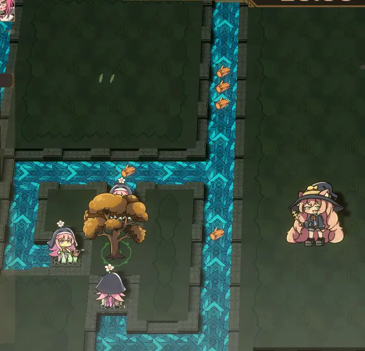

[English](README.en.md)

# LWF Alraune Hotkeys

**Lazy Witch's Factory** 農耕アルラウネにキーで命令を出す MOD

**[最新版をダウンロード](https://github.com/KiyonakaNata/lwf-alraune-hotkeys/releases/latest)** ／ **[Thunderstore](https://thunderstore.io/c/lazy-witchs-factory/p/KiyonakaNata/LwfAlrauneHotkeys/)**（MOD管理ソフトでお手軽導入）

---

## できること

### キーで命令

置いた農耕アルラウネにカーソルを載せてキーを押す

| キー | 命令 |
|---|---|
| `G` | 交配 |
| `H` | 現金 |
| `J` | 採掘 |

- キーを押したままカーソルを動かす → 通った農耕アルラウネ全部に同じ命令
- 所持品欄やウィンドウの上ではキーが効かない
- キーは変更できる（[設定](#設定)）

---

## 入れかた（手で入れる場合）

1. **BepInEx 5** を入れる — [配布元](https://github.com/BepInEx/BepInEx/releases)
   - `BepInEx_win_x64_5.4.x.zip` を落とす
   - 中身をゲームのフォルダ（`LazyWitchsFactory.exe` と同じ場所）へ展開する

     > **ゲームのフォルダの場所**（Steam）
     > ライブラリでゲームを右クリック → 管理 → ローカルファイルを閲覧

2. 一度ゲームを起動して終了すると、`BepInEx/plugins` などが作られる
3. このMODの zip の中の `LwfAlrauneHotkeys.dll` を **`BepInEx/plugins/` に入れる**
4. ゲームを起動し、農耕アルラウネにカーソルを載せて `G` を押す。カーソルを載せたときの情報パネルに「交配 - 植物」などが出れば動いている

## 消しかた

**このMODだけ消す**

- `BepInEx/plugins/LwfAlrauneHotkeys.dll`
- 設定も消すなら `BepInEx/config/kiyonakanata.lwfalraunehotkeys.cfg`

**BepInEx ごと消す**（他のMODも全部止まる）

- `BepInEx` フォルダ
- ゲームのフォルダにある `winhttp.dll`、`doorstop_config.ini`、`.doorstop_version`

---

## 設定

`BepInEx/config/kiyonakanata.lwfalraunehotkeys.cfg`（ゲームを一度起動すると作られる）

MOD管理ソフトで入れた場合は、管理ソフトの Config editor から開く

**[1. General]**

| 項目 | 既定 | 値 |
|---|---|---|
| Enabled | `true` | |
| Apply while held | `true` | `false` で押した瞬間の 1 体だけ |

**[2. Keys]**

| 項目 | 命令 | 既定 | 値 |
|---|---|---|---|
| Crossbreeding | 交配 | `G` | キー名（`G`・`F5`・`Digit1`・`Numpad1` など）。`None` で無効 |
| Cash | 現金 | `H` | 同上 |
| Mining | 採掘 | `J` | 同上 |

本体のキーコンフィグで使っているキーは選ばない

---

## 動作の条件

| | |
|---|---|
| Lazy Witch's Factory | **ver 0.30.1** で動作確認 |
| BepInEx | **5.4.23.5** で確認（5.4.x なら動くはず） |

本体の更新で動かなくなったら、このMODの寿命なので消すこと

## うまく動かないとき

まず `BepInEx/LogOutput.log` を見る

| ログ | いまどうなっているか |
|---|---|
| `[boot] LWF Alraune Hotkeys ...` が無い | **読まれていない** — DLL の置き場所を確認 |
| `[boot]` か `[tick]` の行に `disabled` | **止まっている** — ゲームの版が合っていない |

**不具合の報告**には次の2つを添えること

- 画面の写真
- `BepInEx/LogOutput.log`

---

## 免責

- **非公式のMOD** — 公式のサポート対象外
- MODを入れた状態で起きた不具合・クラッシュ・セーブデータの破損などは自己責任
- [公式のMODに関する方針](https://store.steampowered.com/news/app/3971650/view/699897618302503133)に従って作成

ソースコードは MIT ライセンス
